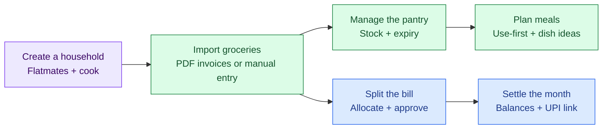
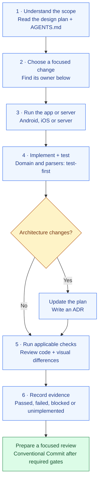
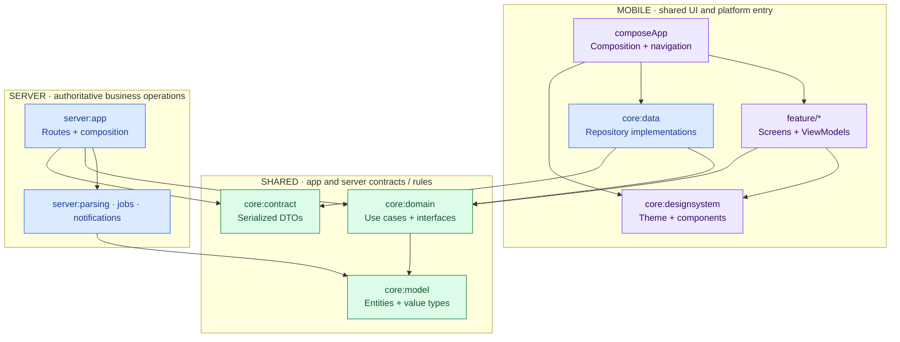
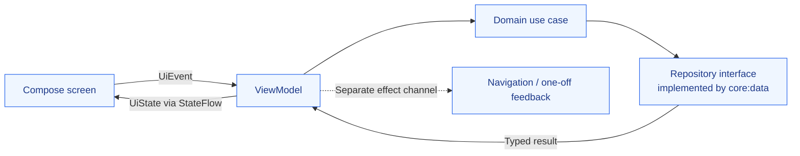
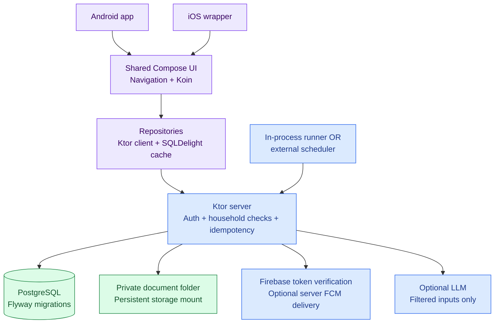
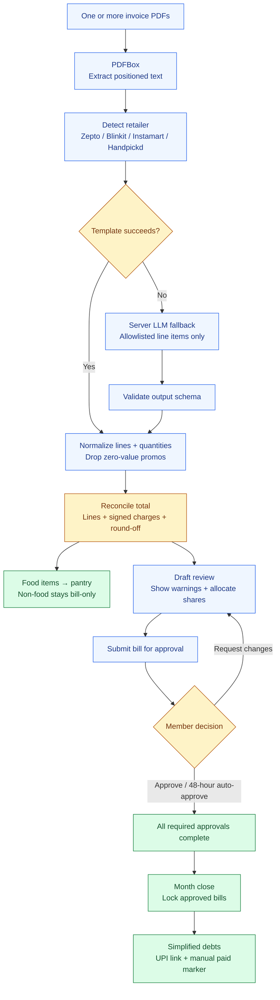
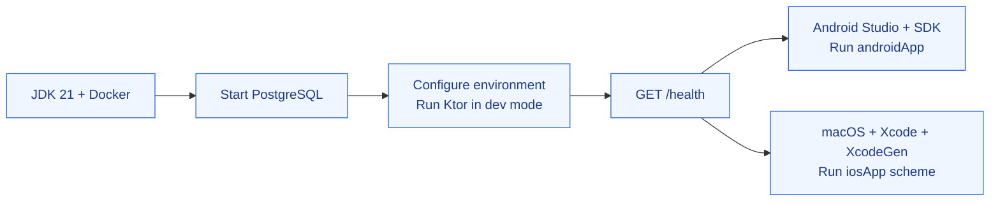
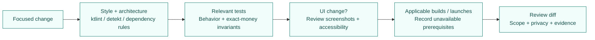

# Rasoi

**One household. A shared pantry. Fair grocery bills.**

*Aapke ghar ki rasoi*

Android + iOS · Shared Kotlin · Fair to the last paise

**[Start contributing](#start-contributing)** &nbsp; / &nbsp; **[Run locally](#run-locally)** &nbsp; / &nbsp; **[Architecture](#how-the-code-fits-together)** &nbsp; / &nbsp; **[Tech stack](#the-stack)**

Rasoi helps flatmates import grocery invoices, track food, split bills and settle monthly balances.

> [!NOTE]
> **Project status:** Phase 1 workflows are implemented on `main`. The [milestone record](docs/milestones.md) documents M0–M7 and verification limits. Build/test coverage is not proof of production readiness; see [remaining integration work](#what-still-needs-validation).

## The stack

<table>
<tr>
<th align="center">📱 App & shared UI</th>
<th align="center">⚙️ Backend & data</th>
<th align="center">☁️ Build & delivery</th>
</tr>
<tr>
<td align="center">

 <strong>Kotlin · Compose Multiplatform</strong> 
One shared UI and domain layer
  

 Android · iOS
</td>
<td align="center">

 <strong>Ktor · PostgreSQL</strong> 
Server-owned financial state
  

 Firebase auth · server push
</td>
<td align="center">

 <strong>Gradle · Docker</strong> 
Reproducible builds and services
  

 GitHub Actions · Cloud Run
</td>
</tr>
</table>

**Also in the stack:** Koin for dependency injection · SQLDelight for cached reads · PDFBox for invoice extraction · Flyway for database migrations.

[Version catalog](gradle/libs.versions.toml) · [Stack details](docs/project-guide.md#build-and-runtime-reference) · [Icon credits](docs/assets/stack/README.md)

---

## The product at a glance

## Start contributing

Read the complete [design plan](docs/design-plan.md) and [AGENTS.md](AGENTS.md), then pick a focused change.

Use a branch based on current `main` and a focused PR. Follow the repository's pre-commit review workflow; report checks that cannot run. Do not infer milestone completion from a successful build.

### Where should my change go?

| I want to change… | Start here |
| --- | --- |
| Android launch, sign-in integration or manifest | [`androidApp`](androidApp) |
| iOS wrapper and platform setup | [`iosApp`](iosApp) |
| Navigation, app state or dependency injection | [`composeApp`](composeApp) |
| Colors, typography or reusable controls | [`core/designsystem`](core/designsystem) |
| Money, quantities, IDs or typed results | [`core/model`](core/model) |
| Split, settlement, expiry algorithms or repository interfaces | [`core/domain`](core/domain) |
| HTTP repositories and offline caches | [`core/data`](core/data) |
| Shared request/response DTOs | [`core/contract`](core/contract) |
| Screens, events, UI state and ViewModels | [`feature/`](feature) |
| Routes, authorization, persistence and business orchestration | [`server/app`](server/app) |
| PDF extraction, templates and LLM fallback | [`server/parsing`](server/parsing) |
| Job runner or notification delivery | [`server/jobs`](server/jobs), [`server/notifications`](server/notifications) |
| Test fakes and builders | [`core/testing`](core/testing) |
| Build conventions or dependencies | [`build-logic`](build-logic), [`build-logic-android`](build-logic-android), [version catalog](gradle/libs.versions.toml) |

**Feature owners:** `household` → auth/roles · `invoiceimport` → picking/review · `pantry` → stock · `bills` → allocation/approval · `ledger` → balances/settlement · `kitchen` → use-first/suggestions.

A small first change can improve documentation, add an edge-case test to a pure algorithm, or refine a design-system component with reviewed screenshots. Use the existing tests as your starting point.

## How the code fits together

### Dependency direction

Arrows mean **depends on**. This is a simplified map; [AGENTS.md](AGENTS.md) defines the complete allowed module graph. Android and iOS wrappers host `composeApp`.

| Boundary | Contributor rule |
| --- | --- |
| Feature → feature | Keep features independent; connect them in `composeApp` |
| Domain → platform/UI/data | Keep domain pure; data implements domain interfaces |
| Product UI → Material | Use design-system tokens/components; strings go in resources |
| Production → test helpers | Use `core:testing` only in test source sets |

`./gradlew verifyModuleGraph verifyFeatureSources` checks module boundaries and feature UI rules.

### A screen's data flow

### Runtime services

The server owns final financial state. Offline caches support reads; writes need an online response. Hosted deployment uses Cloud Run, Neon and a mounted Cloud Storage folder, with external sweep scheduling. [Hosting decision →](docs/adr/0028-hosting-on-cloud-run-and-neon.md)

## How groceries become shared expenses

Pantry items are created during import, before approval. The review's food toggle can adjust this; [ADR 0020](docs/adr/0020-pantry-from-bills.md) defines the update rules. A successful LLM fallback must pass validation; failures return typed errors rather than guessed totals.

| Invariant | Why it matters |
| --- | --- |
| `Long` paise + largest-remainder rounding | Allocations sum exactly to their source amount |
| Integer base-unit quantities | Consistent count, weight and volume calculations |
| Household/role checks + idempotency keys | Authorized writes; retries do not duplicate bills |
| Approved-bill edits reset affected approvals | Changed shares require reapproval |
| Household-zone month boundaries | Unapproved bills roll into the next period |
| Cooks have no bill share | Kitchen access is separate from financial allocation |

[Schema, API and algorithms →](docs/design-plan.md#6-low-level-design-lld)

## Run locally

Use **JDK 21** and the checked-in **Gradle 9.8.0** wrapper. Current pins are Kotlin **2.4.21**, Compose **1.12.1**, AGP **9.4.1** and Ktor **3.6.0**; the [version catalog](gradle/libs.versions.toml) is authoritative.

Follow [Running locally](docs/running-locally.md) for the database command and complete environment setup. Server startup requires `DATABASE_URL`, `DATABASE_USER`, `DATABASE_PASSWORD` and either local `RASOI_AUTH_MODE=dev` or Firebase configuration. Flyway applies migrations on startup.

| Task | Command / entry |
| --- | --- |
| Start configured server | `./gradlew :server:app:run` |
| Check server response | `curl --fail http://localhost:8080/health` |
| Build Android debug APK | `./gradlew :androidApp:assembleDebug` |
| Install on Android emulator | `./gradlew :androidApp:installDebug` |
| Generate/open iOS wrapper | `cd iosApp && xcodegen generate && open iosApp.xcodeproj` |
| Seed an empty development database via the server | `RASOI_DEMO_URL=http://localhost:8080 ./gradlew :server:app:seedDemo` |

Android emulator debug builds use `http://10.0.2.2:8080`; iOS uses `RASOI_API_BASE_URL` (default `http://localhost:8080`). Android overrides use `-Prasoi.apiBaseUrl=...`. Release builds require HTTPS. Development sign-in is for local development only.

Platform switches (`rasoi.android`, `rasoi.compose`, `rasoi.ios`) support limited environments; disabled targets are **not** verified targets. See [AGENTS.md](AGENTS.md#platform-switches-adr-0007).

## Before a change is ready

| Check | Command |
| --- | --- |
| Full configured quality gate | `./gradlew check` |
| Style and static analysis | `./gradlew ktlintCheck detekt` |
| Architecture and feature UI rules | `./gradlew verifyModuleGraph verifyFeatureSources` |
| Domain tests | `./gradlew :core:domain:jvmTest` |
| Server routes and demo scenario; Docker required | `./gradlew :server:app:test` |
| Reviewed screenshot comparison | `./gradlew verifyRoborazziJvm` |
| iOS simulator tests; macOS required | `./gradlew iosSimulatorArm64Test` |
| Resource declarations/imports | `python3 scripts/check-compose-resources.py` |
| Existing invoice-file guard | `./scripts/check-no-real-invoices.sh` |

**UI review:** loading / empty / error / content · light / dark · 48 dp targets · text labels · AA contrast · 200% text. Review screenshot differences before accepting new goldens.

**Domain and parsers:** test-first. Domain line coverage target is 90%; use fixed-seed invariant tests for exact sums and settlement. The HTTP demo scenario lives in `server/app` tests.

The [CI workflow](.github/workflows/ci.yml) checks guards, JVM/Compose/Android and iOS. [PR lint](.github/workflows/lint.yml) also runs Android lint. Self-hosted macOS fallback skips Linux screenshot comparison; report that limitation. [CI setup →](docs/ci.md)

## What still needs validation?

The [milestone record](docs/milestones.md) lists M0–M7 completion commits and CI evidence, with explicit screenshot limitations. The [runtime guide](docs/running-locally.md#what-is-not-production-ready-yet) separately records:

- Real Firebase sign-in needs provider/device validation; successful compilation does not establish it.
- Server push exists, but client FCM token acquisition/registration remains work.
- Release shrinking is disabled pending device-tested keep rules.
- Document storage uses a folder/mount; a dedicated S3 storage implementation is not built.
- Some Linux screenshot goldens still need recording/review and verification after self-hosted milestone checks.

These are recorded limitations, not fresh runtime checks performed for this documentation.

## Keep private inputs private

| Input | Contribution rule |
| --- | --- |
| Private invoice PDFs and derived text/JSON/images | Keep local; do not add or relocate them into tracked files |
| New reproducible parser examples | Prefer independently fabricated, non-personal test builders |
| Secrets, tokens and service-account keys | Environment or ignored local configuration |
| LLM input | Filtered line-item text only; never personal headers or raw PDFs |

The existing repository guard permits historical redacted fixture and golden files; it checks file names, not proof of anonymization. Do not treat that permission as authorization to publish private inputs. Keep PII out of logs, screenshots and diffs.

## Explore further

| Need | Read |
| --- | --- |
| Module responsibilities and contributor reference | [Project guide](docs/project-guide.md) |
| Full product scope, schema and API | [Design plan](docs/design-plan.md) |
| Coding conventions and definition of done | [AGENTS.md](AGENTS.md) |
| Architecture decisions | [ADR index](docs/adr/README.md) |
| Local setup, release configuration and deployment | [Running locally](docs/running-locally.md) |
| Recorded milestones and remaining verification | [Milestones](docs/milestones.md) |
