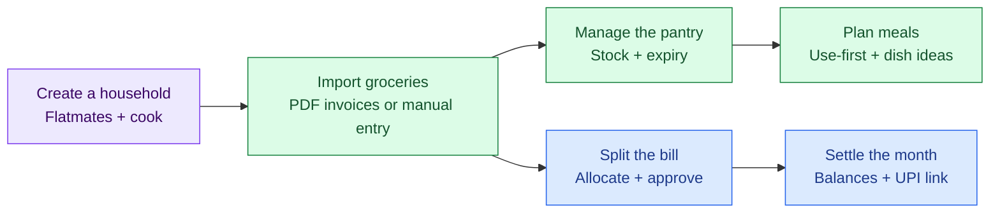
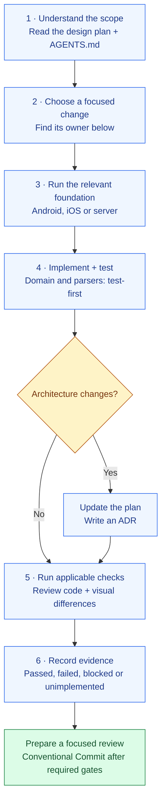
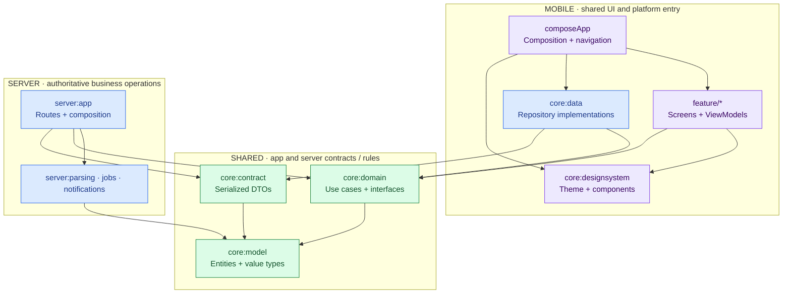
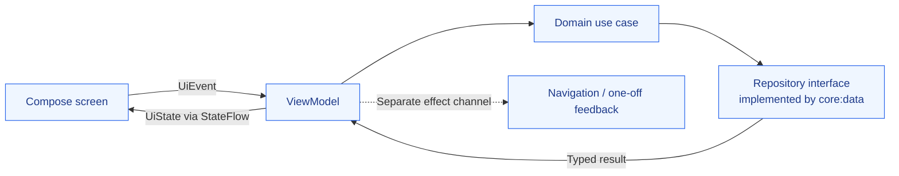
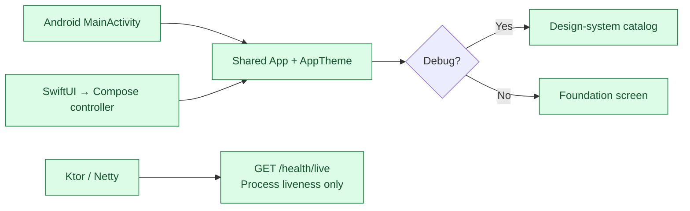
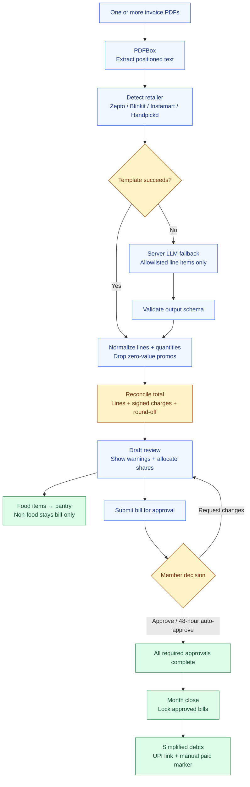
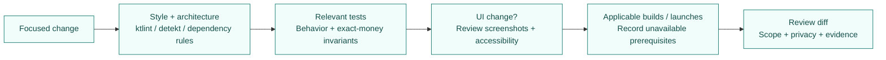

<div align="center">

# RasoiSaathi

**One household. A shared pantry. Fair grocery bills.**

Android + iOS · Kotlin Multiplatform · Kotlin server

[Start contributing](#start-contributing) · [Run locally](#run-locally) · [Architecture](#how-the-code-fits-together) · [Detailed guide](docs/project-guide.md)

</div>

> **M0 · Foundation in development**
> The UI catalog and server liveness endpoint work. Product workflows are planned. [Recorded local verification →](docs/verification/m0.md)

## The product at a glance

**Planned Phase 1 experience** — these workflows are not implemented yet.



## What can I use today?

| Available foundation | Planned product work |
| --- | --- |
| Android and iOS entry points | Sign-in, households and invitations |
| Shared design-system catalog | Invoice parsing and review |
| Light/dark components and screenshot tests | Pantry, expiry and kitchen workflows |
| `GET /health/live` → `{"status":"up"}` | Bill approval, ledger and settlement |
| Build conventions and quality gates | Persistence, caching and provider integrations |

**A module shell is a place to build a feature, not a working feature.** CI is configured; the recorded evidence does not claim a GitHub Actions run.

## Start contributing



Read [the complete design plan](docs/design-plan.md) and [AGENTS.md](AGENTS.md) before changing code. The current workflow specifies `m0/rasoisaathi-foundation`; **pushes require explicit user authorization**. Commits and milestone tags require all applicable gates to pass.

### Where should my change go?

| I want to change… | Start here | Status |
| --- | --- | --- |
| Colors, typography, reusable controls | [`core/designsystem`](core/designsystem) | Implemented foundation |
| App launch, navigation or DI composition | [`composeApp`](composeApp), [`iosApp`](iosApp) | Launch exists; navigation/DI planned |
| Money, quantities or typed IDs | [`core/model`](core/model) | Shell |
| Splits, balances, expiry or repository interfaces | [`core/domain`](core/domain) | Shell |
| Networking, repositories or offline reads | [`core/data`](core/data) | Shell |
| Shared API messages | [`core/contract`](core/contract) | Liveness DTO only |
| A product screen and its ViewModel | [`feature/`](feature) | Six feature shells |
| Routes, server auth or composition | [`server/app`](server/app) | Liveness route only |
| PDF extraction and retailer parsers | [`server/parsing`](server/parsing) | Shell |
| Scheduled work or push delivery | [`server/jobs`](server/jobs), [`server/notifications`](server/notifications) | Shells |
| Fakes and synthetic builders | [`core/testing`](core/testing) | Test dependency shell |
| Build rules or dependency versions | [`build-logic`](build-logic), [version catalog](gradle/libs.versions.toml) | Configured |

**Feature owners:** `household` → auth/roles · `invoiceimport` → picking/review · `pantry` → stock · `bills` → allocation/approval · `ledger` → balances/settlement · `kitchen` → use-first/suggestions.

For a small first change, inspect a design-system component and its tests, improve documentation, or strengthen an existing liveness test. Product features should follow the milestone scope.

## How the code fits together

### Dependency direction

Arrows mean **depends on**. This is a simplified map of the intended boundaries; modules exist, but most business implementations are still shells.



| Boundary | Contributor rule |
| --- | --- |
| Feature → feature | Keep features independent; connect them in `composeApp` |
| Domain → platform/UI/data | Keep domain pure; data implements domain interfaces |
| Product UI → Material | Use design-system tokens/components; strings go in resources |
| Production → test helpers | Use `core:testing` only in tests |

`./gradlew checkArchitecture` checks project dependency rules. [Full module/build reference →](docs/project-guide.md#repository-map)

### A screen's data flow — planned



### What launches today



Catalog controls demonstrate states; they do not operate real bills or pantry data. The mobile app has no implemented business API flow yet.

## How groceries will become shared expenses

**Planned M2–M5 flow.** All financial results are finalized on the server.



| Invariant | Why it matters |
| --- | --- |
| `Long` paise + largest-remainder rounding | Every allocation sums exactly to its source amount |
| Integer base-unit quantities | Consistent count, weight and volume calculations |
| Household/role checks + idempotency keys | Authorized writes; retries do not duplicate bills |
| Approved-bill edits reset affected approvals | Changed shares require reapproval |
| Household-zone month boundaries | Unapproved bills roll into the next period |
| Offline reads; online-only writes | Cached data is readable; final writes require the server |

[Detailed schema, API and financial rules →](docs/design-plan.md#6-low-level-design-lld)

## Run locally

**Common tools:** JDK **21** · Gradle wrapper **8.14.3** · Kotlin **2.2.20** · Compose **1.9.0**. Run commands at the repository root.

| Target | Extra setup | Start / build | What to expect |
| --- | --- | --- | --- |
| Android | SDK platform 36, build tools 35.0.0; `ANDROID_HOME` or local `sdk.dir` | `./gradlew :composeApp:assembleDebug` | Debug APK; run `composeApp` from Android Studio |
| iOS | macOS, full Xcode, simulator; JDK visible to Xcode | Open `iosApp/iosApp.xcodeproj`, scheme **RasoiSaathi**, Run | Shared catalog in the simulator |
| Server | JDK 21; Gradle configuration may also require Android SDK | `./gradlew :server:app:run` | Foreground server on `127.0.0.1:8080` |

In a second terminal, check the server:

```sh
curl --fail http://127.0.0.1:8080/health/live
# Expected: {"status":"up"}
```

`HOST` and `PORT` override the server bind address. Stop it with Ctrl+C. PostgreSQL and provider credentials are not needed for liveness.

<details>
<summary><strong>More setup: APK install, Xcode CLI, local toolchains and PostgreSQL</strong></summary>

See [local development](docs/project-guide.md#local-development) for exact commands and optional `.tools/` environment paths. Those tools are local downloads, not included in the checkout.

`compose.yaml` provisions PostgreSQL for future persistence work. Set `POSTGRES_PASSWORD` in your environment or ignored `.env` before `docker compose up -d postgres`. The app does not yet connect to a schema.

Android minimum SDK is 26. The iOS wrapper declares 16.0, but minimum-version compatibility is not validated by existing launch evidence.

</details>

## Before a change is ready



| Check | Command |
| --- | --- |
| All configured checks | `./gradlew check` |
| Style and static analysis | `./gradlew ktlintCheck detekt` |
| Dependency and fixture guards | `./gradlew checkArchitecture checkPrivateFixtures` |
| Server behavior | `./gradlew :server:app:test` |
| Shared presentation rules | `./gradlew :core:designsystem:jvmTest` |
| Reviewed screenshot comparison | `./gradlew verifyRoborazzi` |
| Full automated foundation gate | `./gradlew verifyM0` |

**UI review:** loading / empty / error / content · light / dark · 48 dp targets · text labels · AA contrast · 200% text. The catalog has **58 cases**, **19 groups** and **236 reviewed screenshot baselines**. Review differences; never regenerate baselines simply to pass.

`verifyM0` requires platform toolchains and builds the Android APK and arm64 iOS simulator framework. Device launches and standalone-server startup are separate checks. The domain's 90% coverage gate is configured, but no domain behavior exists to measure yet.

<details>
<summary><strong>CI and verification limits</strong></summary>

[CI configuration](.github/workflows/ci.yml) has Ubuntu Android/server and macOS iOS jobs, including runtime smoke checks and report artifacts. It has not been executed according to the recorded evidence.

[M0 evidence](docs/verification/m0.md) records passing local checks and launches on an Android API 35 arm64 emulator and iOS 27.0 simulator. Physical devices, oldest supported OS versions, signing and release builds remain unverified. These are historical results, not a fresh run for this documentation change.

</details>

## Keep private inputs private

| Input | Where it belongs |
| --- | --- |
| Real invoices and **all** derived text, JSON or images | Ignored `fixtures/invoices/`; never committed or relocated into tracked paths |
| Independently fabricated parser examples | Module test source sets; safe for reproducible CI |
| Secrets and credentials | Environment or ignored local configuration |
| LLM input | Allowlisted line-item text only; never raw PDFs or personal headers |

Full private invoice regression is required before M2 closes, independently of synthetic CI tests. Missing private inputs block that gate. Never include personal data in logs, screenshots or diffs. [Privacy decision →](docs/adr/0006-private-invoice-fixtures.md)

## Roadmap

```mermaid
flowchart LR
    M0["M0 · CURRENT<br/>Foundation"] --> M1["M1 · PLANNED<br/>Household + auth"]
    M1 --> M2["M2 · PLANNED<br/>Invoice import"]
    M2 --> M3["M3 · PLANNED<br/>Pantry"]
    M3 --> M4["M4 · PLANNED<br/>Bills + approvals"]
    M4 --> M5["M5 · PLANNED<br/>Ledger + settlement"]
    M5 --> M6["M6 · PLANNED<br/>Kitchen"]
    M6 --> M7["M7 · PLANNED<br/>Hardening"]
    classDef current fill:#dcfce7,stroke:#15803d,color:#14532d,stroke-width:3px
    classDef planned fill:#f8fafc,stroke:#64748b,color:#334155,stroke-dasharray:5 5
    class M0 current
    class M1,M2,M3,M4,M5,M6,M7 planned
```



The complete end-to-end acceptance scenario belongs to M7. Earlier milestones demonstrate only their implemented scope.

| Need more detail? | Read |
| --- | --- |
| Full module map, stack, setup and engineering rules | [Detailed project guide](docs/project-guide.md) |
| Product scope, schema, API and acceptance criteria | [Design plan](docs/design-plan.md) |
| Contribution boundaries and definition of done | [AGENTS.md](AGENTS.md) |
| Why the architecture works this way | [Architecture decisions](docs/adr/README.md) |
| What was actually checked | [M0 verification](docs/verification/m0.md) |
