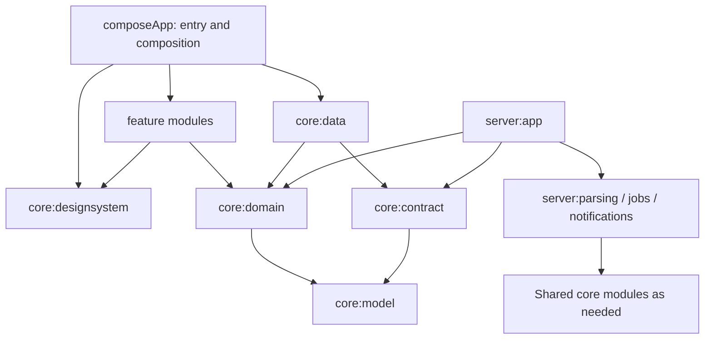

# RasoiSaathi — detailed project guide

RasoiSaathi is a Kotlin Multiplatform project for managing a shared household's groceries, pantry and expenses on Android and iOS, backed by a Kotlin server.

**Current stage: M0 foundation.** The shared UI catalog, platform entry points, build infrastructure and server liveness endpoint exist. Household sign-in, invoice import, pantry management, bill splitting, settlement and kitchen workflows are planned for M1–M7. A module or dependency being present does not mean its feature is implemented.

The [Phase 1 design plan](design-plan.md) defines the product and acceptance criteria. [M0 verification](verification/m0.md) records previous local checks and platform launches; it is not a fresh verification of every checkout. This guide describes the source and configuration currently present.

[← Visual overview and contributor start](../README.md)

## Contents

- [Product scope and status](#product-scope-and-status)
- [Repository map](#repository-map)
- [Architecture](#architecture)
- [Current runtime](#current-runtime)
- [Technology and build](#technology-and-build)
- [Local development](#local-development)
- [Design system](#design-system)
- [Testing and CI](#testing-and-ci)
- [Privacy and contribution rules](#privacy-and-contribution-rules)
- [Further reading](#further-reading)

## Product scope and status

Phase 1 targets flatmates and cooks sharing a household: import grocery receipts, track food and expiry, allocate costs fairly, approve bills and settle monthly balances.

| Milestone | Intended outcome | Current status |
| --- | --- | --- |
| M0 — Foundation | Build, modules, design system, CI, Android/iOS launch | Implemented foundation; prior local gates passed, delivery remains uncommitted per evidence |
| M1 — Household | Phone OTP, household creation, invitations, owner/member/cook roles | Planned |
| M2 — Invoice import | Zepto, Blinkit, Instamart and Handpickd parsing; reconciliation and draft review | Planned |
| M3 — Pantry | Food stock, locations, manual edits and expiry estimates | Planned |
| M4 — Bills | Per-line allocation, approvals, change requests and auto-approval | Planned |
| M5 — Ledger | Month close, simplified debts, UPI link and manual paid marker | Planned |
| M6 — Kitchen | Use-first list, expiry alerts and stock-based dish suggestions | Planned |
| M7 — Hardening | Full acceptance scenario, accessibility and release builds | Planned |

Voting, cook WhatsApp notifications, cooking preferences, shopping suggestions and a marketplace are outside Phase 1. Barcode scanning is a stretch goal at the end of Phase 1. Server/database hosting remains undecided.

## Repository map

Gradle paths use `:` where directories use `/`. There are 17 explicitly included application, core, feature and server modules. `iosApp` is an Xcode project; `build-logic` is a separate included Gradle build.

| Path / module | Responsibility | What exists today |
| --- | --- | --- |
| `composeApp` | Shared app entry; future navigation and DI composition | Android Activity, common `App`, iOS controller, framework build |
| `iosApp` | SwiftUI launch and Xcode wrapper | Shared `RasoiSaathi` scheme and Kotlin framework integration |
| `core:model` | Entities, typed IDs, `Money`, `Quantity` | Build shell; domain models are not implemented |
| `core:domain` | Use cases, algorithms and repository interfaces | Build shell with 90% coverage gate configured |
| `core:data` | Repository implementations, networking and local cache | Ktor/SQLDelight dependencies; no repositories or database schema |
| `core:contract` | Serialized DTOs shared by app and server | `LivenessDto` |
| `core:designsystem` | Theme, tokens, components and debug catalog | Shared components, presentation helpers and tests |
| `core:testing` | Test fakes and synthetic builders | Test dependency shell; no builders/fakes yet |
| `feature:household` | Authentication, setup, invites and roles | Build shell |
| `feature:pantry` | Stock, locations and manual changes | Build shell |
| `feature:invoiceimport` | PDF picking and draft review | Build shell |
| `feature:bills` | Allocation, submission and approval | Build shell |
| `feature:ledger` | Balances, month close and settlement | Build shell |
| `feature:kitchen` | Use-first and dish suggestions | Build shell |
| `server:app` | Ktor entry, routing; future auth and server DI | Netty server, JSON liveness route and three route tests |
| `server:parsing` | PDF extraction, templates and server-only fallback | Build shell with PDFBox dependency |
| `server:jobs` | Durable approval, expiry and month-close scheduling | Build shell |
| `server:notifications` | FCM delivery | Build shell with Firebase Admin dependency |

Other important locations:

- `build-logic/`: shared multiplatform, Compose, server and quality convention plugins.
- `gradle/libs.versions.toml`: dependency and plugin version source of truth.
- `config/detekt.yml`, `.editorconfig`: static-analysis and formatting rules.
- `.github/workflows/ci.yml`: Android/server and iOS verification jobs.
- `compose.yaml`: local PostgreSQL provisioning for future persistence work.
- `docs/`: design plan, ADRs, kickoff instructions and verification evidence.
- `.claude/skills/`: repository workflows for features, parsers, components, ADRs and pre-commit review.
- `fixtures/invoices/`: entirely ignored private local inputs, including derived files.
- `.tools/`: optional ignored local toolchains, caches and evidence; not supplied by the repository.

## Architecture

### Dependency boundaries

The intended application flow is Compose UI → ViewModel → domain use cases/repository interfaces, with `core:data` implementing those interfaces. The current foundation has no product ViewModels or repository implementations.



Arrows describe project dependency direction, not implemented network calls. `checkArchitecture` validates allowed project dependencies across configurations, including test source sets. It does not replace source-level architectural review.

- Features depend on core modules and the design system, never another feature or `core:data`.
- Cross-feature navigation and dependency injection belong in `composeApp`.
- Domain logic stays free of UI, data, Android/iOS and server-framework imports.
- App and server share models, domain algorithms and contract DTOs, not persistence entities.
- `core:testing` is permitted only as a test dependency outside its own module.
- Platform integrations should be thin interfaces for file picking, sharing, notifications and secure storage.

Future screens use immutable `…UiState` exposed through `StateFlow`, sealed `…UiEvent` inputs and a separate one-off effect channel. Composable state is hoisted. Navigation Compose and Koin dependencies are wired, but the product navigation graph and DI modules are not implemented.

### Planned system and data flow

The mobile app will call Ktor business APIs. The server will own PostgreSQL access, private invoice storage, token verification, scheduled jobs and LLM calls. SQLDelight will cache pantry and ledger reads; Phase 1 writes require a successful online response, with no deferred mutation queue.

The planned invoice pipeline is:

1. Upload one or more PDFs for a bill.
2. Extract positioned text with PDFBox and detect the retailer from document signatures.
3. Parse retailer templates, including wrapped rows and repeated page headers; use a validated server-only LLM fallback when needed.
4. Normalize names, quantities and categories; drop zero-value promo lines and keep non-food lines out of pantry stock.
5. Reconcile lines, charges, discounts and round-off against the invoice total.
6. Return a draft with warnings for user review and allocation.

Duplicate detection is scoped to household, platform and invoice number. Fees may come from separate PDFs or manual charge lines. These rules are design requirements; no parser is implemented yet.

The planned relational model groups users, households, memberships and invites; bills, documents, lines, charges, allocations and approvals; periods and settlements; pantry items and locations; jobs and device tokens. The exact proposed schema and business API inventory are in [design-plan sections 6.2–6.6](design-plan.md#62-data-model). No migrations or persistence tables currently exist in code.

### Financial and consistency rules

These are requirements for the upcoming domain implementation:

- Money uses `Long` paise, never floating point. Quantities use integer base units: milligrams, millilitres or count × 1000.
- One-person, equal and quantity splits use largest-remainder rounding so shares sum exactly to the original amount. Signed charges and discounts follow the same exact-sum principle.
- Approved bills credit the payer and debit members' shares; period balances sum to zero. Debt simplification matches creditors and debtors with at most `n - 1` transfers.
- The server recomputes and finalizes bills, approvals and ledger outcomes. Business endpoints require household membership/role checks; mutations require idempotency keys.
- Pending approvals auto-approve after 48 hours. An approved-bill edit resets approval only for members whose shares changed.
- UTC instants are stored; household time zones define month boundaries. Month close locks the previous period and moves unapproved bills forward.
- Boundary failures are typed values; retries preserve user input and reuse the mutation's idempotency key.

The existing design-system `formatPaise` helper formats integer amounts for display. It is not the planned `Money` model or a bill-splitting algorithm.

## Current runtime

**Android:** `MainActivity` enables edge-to-edge rendering and calls `App(showCatalog = BuildConfig.DEBUG)`.

**iOS:** the SwiftUI wrapper embeds `MainViewControllerKt.mainViewController`. Swift's `DEBUG` condition selects the catalog. The static Kotlin framework is named `RasoiSaathi`; the wrapper's internal Swift module is `RasoiSaathiIOS` to avoid a name collision.

**Shared UI:** `App` applies `AppTheme`. Debug builds show `DesignSystemCatalogScreen`; other builds show `FoundationScreen`. Catalog sample buttons, rows and selectors demonstrate UI states rather than working household or billing flows.

**Server:** `MainKt` starts Ktor Netty via `EngineMain`. `application.conf` loads `appModule`, which installs JSON content negotiation and one route:

| Method | Path | Response | Meaning |
| --- | --- | --- | --- |
| GET | `/health/live` | `200`, `{"status":"up"}` | Public process liveness only |

The endpoint neither checks database readiness nor creates a session. Business endpoints are absent; tests verify representative paths return 404. See [ADR 0008](adr/0008-operational-liveness.md).

## Technology and build

Versions below reflect the repository pins, not a claim about the latest upstream releases.

| Area | Configuration |
| --- | --- |
| Toolchain | JDK 21; Gradle wrapper 8.14.3 |
| Kotlin / shared UI | Kotlin 2.2.20; Compose Multiplatform 1.9.0; Material 3 inside the design system |
| Android | AGP 8.11.1; compile/target SDK 36; minimum SDK 26; JVM bytecode target 17 |
| iOS | `iosArm64`, `iosSimulatorArm64`, `iosX64`; wrapper deployment target 16.0 |
| Server / serialization | Ktor 3.3.0; kotlinx.serialization 1.9.0 |
| App wiring dependencies | Koin 4.1.1; Navigation Compose 2.9.0 |
| Data dependencies | SQLDelight 2.1.0; PostgreSQL JDBC; Exposed 0.61.0; Flyway 11.13.2 |
| Server integration dependencies | PDFBox 3.0.5; Firebase Admin 9.5.0 |
| Quality / tests | ktlint 1.7.1; detekt 1.23.8; Kover 0.9.2; Roborazzi 1.50.0; Robolectric 4.16 |

Firebase phone OTP/FCM, S3-compatible storage and an OpenAI-compatible server-side LLM service are accepted design choices, not configured integrations. Data and integration dependencies alone do not provide those behaviors.

Convention plugins centralize configuration:

| Plugin | Purpose |
| --- | --- |
| `rasoisaathi.multiplatform` | Android, JVM and three iOS targets; toolchain, Android library defaults and common tests |
| `rasoisaathi.compose` | Multiplatform defaults plus Compose compiler/runtime, foundation, UI and resources |
| `rasoisaathi.server` | JVM server defaults, JDK 21 and Kotlin tests |
| `rasoisaathi.quality` | ktlint and detekt configuration |

Shared modules expose a JVM target for shared-code verification; there is no desktop application entry point. `composeApp` builds Android and iOS applications.

## Local development

### Prerequisites

Install JDK 21 and use the checked-in Gradle wrapper. Android builds need Android SDK platform 36 and build tools 35.0.0; configure `ANDROID_HOME` or `sdk.dir` in ignored `local.properties`. iOS builds need macOS, full Xcode and an installed simulator runtime. Dependency downloads require network access on a fresh machine.

If this checkout has the optional ignored local tooling, the existing setup uses:

```sh
export JAVA_HOME="$PWD/.tools/jdk/Contents/Home"
export ANDROID_HOME="$PWD/.tools/android-sdk"
export ANDROID_USER_HOME="$PWD/.tools/android-user"
export GRADLE_USER_HOME="$PWD/.tools/gradle-home"
export KONAN_DATA_DIR="$PWD/.tools/konan"
export DEVELOPER_DIR=/Applications/Xcode.app/Contents/Developer
```

Only use these paths when they exist. Otherwise use your installed toolchains. Run commands from the repository root.

### Android

```sh
./gradlew :composeApp:assembleDebug
```

Open the repository in Android Studio and run `composeApp` on a device/emulator, or install and launch the built APK:

```sh
adb install -r composeApp/build/outputs/apk/debug/composeApp-debug.apk
adb shell am start -W -n app.rasoisaathi/.MainActivity
```

The application ID is `app.rasoisaathi`; the current app version is `0.1.0`. Expect the design-system catalog in Debug.

### iOS

Open `iosApp/iosApp.xcodeproj`, select the shared **RasoiSaathi** scheme and an available simulator, then run. The Xcode build phase invokes `:composeApp:embedAndSignAppleFrameworkForXcode`; ensure its environment can find JDK 21.

To build the simulator wrapper without signing:

```sh
xcodebuild -project iosApp/iosApp.xcodeproj -scheme RasoiSaathi \
  -configuration Debug -sdk iphonesimulator \
  -destination 'generic/platform=iOS Simulator' \
  -derivedDataPath iosApp/build CODE_SIGNING_ALLOWED=NO build
```

This compiles the wrapper; launching it is a separate check. The declared iOS 16.0 minimum has not been validated by the recorded launch evidence.

### Server

```sh
./gradlew :server:app:run
```

The server runs in the foreground; stop it with Ctrl+C. From another terminal:

```sh
curl --fail http://127.0.0.1:8080/health/live
```

Expected body: `{"status":"up"}`. `HOST` and `PORT` override the default `127.0.0.1:8080`, for example `PORT=18080 ./gradlew :server:app:run`. The liveness route needs neither database setup nor provider credentials.

### Optional PostgreSQL

`compose.yaml` provisions PostgreSQL `17.6-alpine` for future milestones. Provide `POSTGRES_PASSWORD` in your environment or an ignored `.env`, then run:

```sh
docker compose up -d postgres
docker compose ps
```

The database and user are both `rasoisaathi`; the port is bound to `127.0.0.1:5432` and data persists in the `postgres-data` volume. No application connection, schema or migration runs yet. `docker compose stop postgres` stops the service while retaining its data.

## Design system

`core/designsystem` owns Material controls, semantic colors, typography, spacing, shapes, elevation and motion. Feature UI must use its components and tokens; user-facing text belongs in resources.

- Light/dark semantic palettes include success, warning, danger, owed-to-you and you-owe states. Freshness uses text as well as color.
- Spacing follows 4/8/12/16/24/32/48 dp tokens, with 16 dp screen padding and 48 dp touch targets.
- Shape tokens are 8/12/16 dp; motion durations are 150/250 ms.
- Typography includes display, title, body, label and tabular numeric styles. Amount formatting uses Indian digit grouping.
- Components include buttons, cards, top/bottom bars, amounts, expiry chips, pantry/bill rows, split selectors, quantity steppers, member avatars/pickers, approval banners, loading/empty/error views, bottom sheets and confirmation dialogs.

The catalog exposes 58 cases across 19 groups, with a theme toggle and modal previews. Screenshot coverage spans light/dark themes at 100% and 200% font scales: 232 component images plus four catalog-root images. The [baseline review record](verification/m0.md#screenshot-baseline-review) describes agent visual review and its limits; it does not claim human design approval or a complete device accessibility audit.

## Testing and CI

| Command | Purpose |
| --- | --- |
| `./gradlew check` | Module checks, included build-logic checks, architecture/private-fixture guards and Android screenshot verification; native checks where supported |
| `./gradlew ktlintCheck detekt` | Formatting and static analysis |
| `./gradlew :composeApp:assembleDebug` | Android debug APK build |
| `./gradlew :server:app:test` | Liveness contract and absent-business-route tests |
| `./gradlew :core:designsystem:jvmTest` | Shared presentation and contrast tests |
| `./gradlew checkArchitecture checkPrivateFixtures` | Allowed project dependencies and no indexed private fixtures |
| `./gradlew verifyRoborazzi` | Compare Android debug catalog against reviewed baselines |
| `./gradlew verifyM0` | `check`, Android debug build, arm64 iOS simulator framework and screenshot verification |

`verifyM0` needs the platform toolchains and does not launch devices or start the standalone server. Those are separate evidence requirements. Native targets can be unavailable on some hosts; a successful Linux/JVM run does not establish iOS behavior.

Existing tests cover Ktor liveness, amount formatting/member initials, theme contrast/shapes, component interactions, catalog insets/text layout and screenshots. Domain coverage is configured at 90%, but the domain is still a shell: no implemented-domain coverage percentage is claimed. Domain algorithms and parsers must be developed test-first, with exact-money invariants and independently fabricated parser fixtures.

Review screenshot differences before accepting baseline changes. Never regenerate images simply to make a verification failure pass.

The [GitHub Actions workflow](../.github/workflows/ci.yml) defines:

- **Ubuntu Android/server job:** checks, lint, APK/distribution builds, screenshot verification, packaged-server HTTP smoke and API 35 emulator launch.
- **macOS iOS job:** arm64 simulator tests, Xcode wrapper build and simulator process launch.
- Report artifacts uploaded even after failures.

The recorded [M0 evidence](verification/m0.md) reports local automated gates passing, an Android 15/API 35 arm64 emulator launch and an iPhone 18 Pro/iOS 27.0 simulator launch using Xcode 27.0. GitHub Actions is configured but was not executed. Physical devices, oldest supported OS versions, signing and release builds remain unverified. The iOS evidence also records an ICU minimum-version warning requiring follow-up before release.

## Privacy and contribution rules

Everything beneath `fixtures/invoices/` stays private and ignored, including PDFs, redacted text, JSON snapshots, images and nested files. Never force-add these files or copy invoice-derived content into tracked paths. CI parser tests must use independently fabricated examples. Full private real-invoice regression is separately mandatory before M2 closes; missing inputs block that gate, not CI.

Secrets are environment-provided. Do not put tokens, phone numbers, addresses or invoice payloads in logs, screenshots or diffs. Planned PDF storage is private per household with retention limits; only allowlisted line-item text may reach an LLM, never headers or raw PDFs. The evidence notes that earlier invoice blobs remain in Git history; ignore rules do not remove history.

Follow [AGENTS.md](../AGENTS.md) and read the complete design plan before changing the project:

- Use package root `app.rasoisaathi`, inward dependencies and consistent `Screen`, `ViewModel`, `UiState`, `UiEvent`, `Repository`, `UseCase`, `Dto` and `Entity` suffixes.
- Keep one public class per file, immutable state and thin platform code; avoid `!!` and `GlobalScope`.
- Explain non-obvious algorithms and public domain APIs. Justify new dependencies.
- Record architectural deviations in the plan and an ADR.
- Run applicable checks and distinguish passed, failed, blocked and unimplemented work. Review naming, architecture, unrelated changes and private artifacts before committing.
- Use Conventional Commits. The current workflow specifies `m0/rasoisaathi-foundation`; commits and milestone tags are authorized only after applicable gates pass. **Pushes require explicit user authorization.**

M0 demonstrates the foundation. M1–M6 add implemented workflows cumulatively; the full household/import/approval/pantry/settlement scenario in design-plan section 8 is an M7 acceptance gate.

## Further reading

| Document | Read it for |
| --- | --- |
| [Design plan](design-plan.md) | Full scope, schema, parser requirements, API, UI rules and acceptance scenario |
| [Agent guide](../AGENTS.md) | Repository boundaries, coding conventions and definition of done |
| [ADR index](adr/README.md) | PDFBox, integer money, server authority, Firebase, offline policy, privacy and milestone decisions |
| [M0 verification](verification/m0.md) | Exact recorded checks, screenshot review, launch evidence and limitations |
| [Kickoff prompt](kickoff-prompt.md) | Original foundation work instructions |
